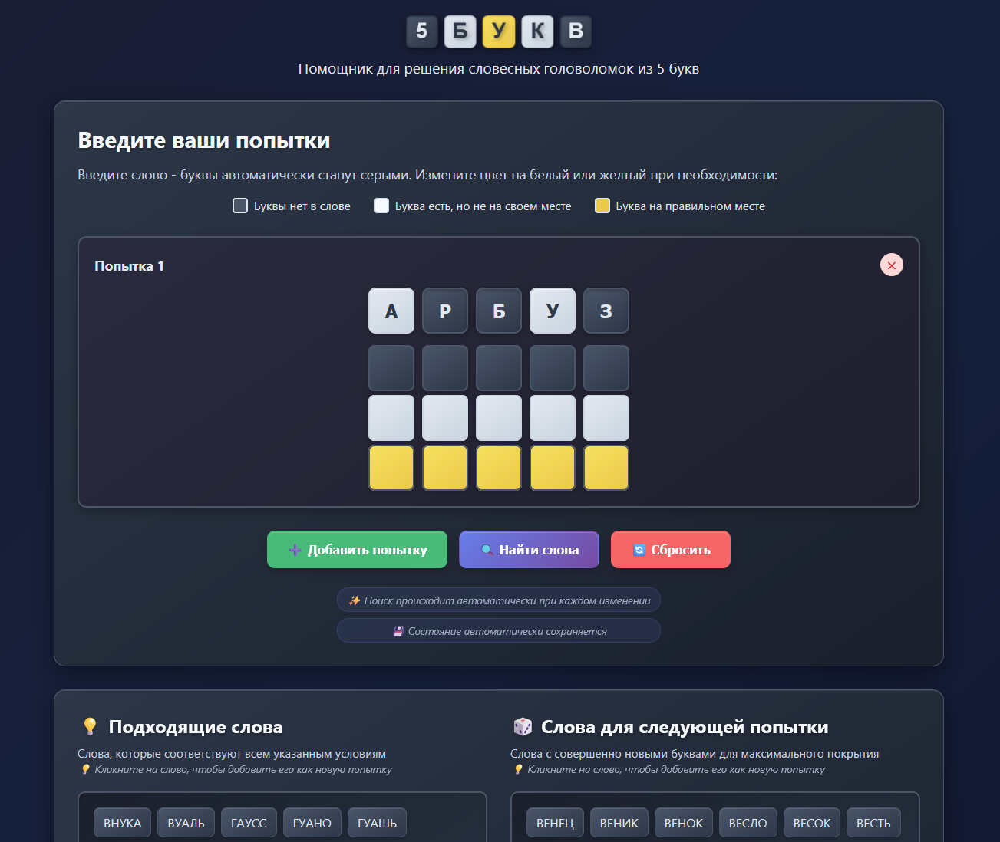

# 🎯 5БУКВ

[](https://virusalex.github.io/wordle/)
[](https://developer.mozilla.org/en-US/docs/Web/HTML)
[](https://developer.mozilla.org/en-US/docs/Web/CSS)
[](https://developer.mozilla.org/en-US/docs/Web/JavaScript)

Веб-помощник для решения словесных головоломок из **5 букв** (Wordle, Вордли и аналогичные игры).

## 🚀 Демо

**🌐 [Попробовать онлайн](https://virusalex.github.io/wordle/)** ← Живая демо-версия на GitHub Pages

Или откройте `index.html` в браузере для локального использования.

## 📸 Скриншот


*Современный темный интерфейс с интуитивным управлением*

## ✨ Возможности

- **Интуитивный интерфейс** - вводите слова и выбирайте цвета букв одним кликом
- **Умный анализ** - алгоритм учитывает все правила игры Вордли
- **Два типа подсказок**:
  - 💡 **Подходящие слова** - варианты, соответствующие всем условиям
  - 🎲 **Слова для следующей попытки** - слова без уже угаданных букв для максимального покрытия
- **Копирование одним кликом** - нажмите на любое слово, чтобы скопировать его
- **Адаптивный дизайн** - работает на всех устройствах

## 🎮 Как использовать

1. **Сыграйте попытку в игре** и получите цветовую обратную связь
2. **Введите слово** на нашей странице 
3. **Выберите цвета** для каждой буквы согласно результату игры:
   - 🔘 **Серый** - буквы нет в загаданном слове
   - ⚪ **Белый** - буква есть в слове, но не на своем месте  
   - 🟡 **Желтый** - буква на правильном месте
4. **Нажмите "Найти слова"** для получения подсказок
5. **Добавьте еще попытки** при необходимости

## 🛠 Технологии

- **HTML5** - структура приложения
- **CSS3** - современный адаптивный дизайн с градиентами и анимациями
- **Vanilla JavaScript** - логика игры без внешних зависимостей
- **Русский словарь** - база из сотен пятибуквенных слов

## 📁 Структура проекта

```
wordle/
├── index.html         # Главная страница
├── styles.css         # Стили приложения  
├── script.js          # Основная логика
├── words.js           # Словарь русских слов
├── favicon.svg        # SVG иконка приложения
├── russian_5chars.txt # Исходный файл со словами
└── README.md          # Документация
```

## 🧠 Алгоритм работы

Приложение реализует ту же логику, что и оригинальное Java-приложение:

1. **Анализ цветовых подсказок** - создание правил для каждой буквы
2. **Фильтрация словаря** - применение всех правил к базе слов
3. **Умная выборка** - отдельный список слов для следующих попыток

## 🚀 Развертывание на GitHub Pages

1. Форкните репозиторий
2. Перейдите в Settings → Pages
3. Выберите источник: `Deploy from a branch`
4. Выберите ветку `main` и папку `/ (root)`
5. Ваш сайт будет доступен по адресу: `https://ваш-username.github.io/имя-репозитория`

## 🤝 Вклад в проект

Приветствуются улучшения и дополнения! Создавайте Issue или Pull Request.

## 📜 Лицензия

MIT License - используйте свободно для личных и commercial проектов.

---

**Создано с 💙 для любителей головоломок** 