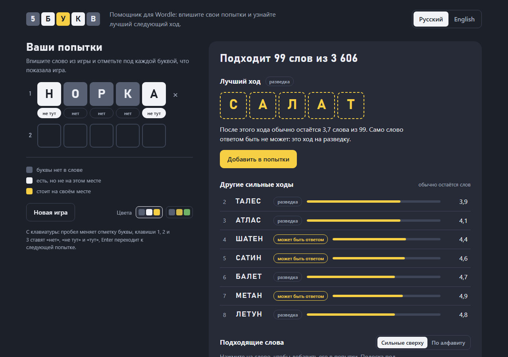
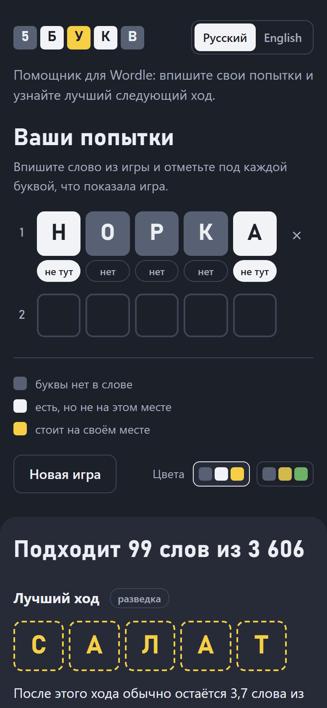

# 🎯 5БУКВ

[](https://virusalex.github.io/wordle/)
[](https://developer.mozilla.org/en-US/docs/Web/HTML)
[](https://developer.mozilla.org/en-US/docs/Web/CSS)
[](https://developer.mozilla.org/en-US/docs/Web/JavaScript)

Веб-помощник для решения словесных головоломок из **5 букв** (Wordle, Вордли и аналогичные игры).
Вы вписываете свои попытки, помощник показывает подходящие слова и самый сильный следующий ход.

## 🚀 Демо

**🌐 [Попробовать онлайн](https://virusalex.github.io/wordle/)** ← Живая демо-версия на GitHub Pages

Или откройте `index.html` в браузере: всё работает локально и без интернета.

## 📸 Скриншоты





## ✨ Возможности

- **Лучший ход** - помощник оценивает каждое слово словаря и показывает то, после которого
  обычно остаётся меньше всего вариантов; рядом список других сильных ходов
- **Проверка букв** - отдельный список слов, которые разом проверяют больше всего невыясненных
  букв; под каждой буквой видно, в какой доле подходящих слов она есть
- **Подходящие слова** - все слова, не противоречащие отметкам, сильные сверху; у каждого слова
  полоска силы хода, три сильнейших выделены
- **Частые слова важнее редких** - редкие слова показаны бледнее и меньше влияют на оценку ходов:
  их загадывают нечасто
- **Быстрый ввод** - буквы печатаются подряд, цвет меняется нажатием на отметку под буквой
  или с клавиатуры (пробел, 1, 2, 3); слово можно вставить из буфера целиком
- **Два языка словаря** - русский и английский; язык запоминается, попытки хранятся отдельно
- **Две раскраски** - серый, белый, жёлтый или серый, жёлтый, зелёный: выберите ту, что в вашей игре
- **Добавление одним нажатием** - нажмите на любое слово в подсказках, и оно встанет в попытки
  и скопируется в буфер обмена
- **Адаптивный дизайн** - на телефоне всё помещается в одну колонку

## 🎮 Как использовать

1. **Сыграйте попытку в игре** и посмотрите, как она раскрасила буквы
2. **Выберите язык словаря** и впишите слово в строку попытки
3. **Отметьте каждую букву** под её клеткой:
   - **нет** - буквы нет в загаданном слове
   - **не тут** - буква есть в слове, но не на этом месте
   - **тут** - буква стоит на своём месте
4. **Посмотрите подсказки** - они пересчитываются сами после каждого изменения
5. **Нажмите на слово**, которым хотите сходить, и повторите с новой раскраской

Буква, уже найденная на своём месте, отмечается сама, когда вы вписываете её туда же в следующей попытке.
«Новая игра» очищает попытки выбранного языка; случайное нажатие можно отменить.

## 🧠 Как выбирается лучший ход

1. **Отбор слов.** Каждая попытка задаёт условия: какие буквы стоят на местах, какие есть в слове
   и сколько раз, каких нет. Повторяющиеся буквы учитываются: если одна «а» отмечена «не тут»,
   а другая «нет», в слове ровно одна «а».
2. **Оценка хода.** Любое слово словаря, сыгранное следующим, разделит оставшиеся слова на группы
   по раскраске, которую покажет игра. Чем мельче и ровнее группы, тем больше ход сообщает.
   Мера этого - энтропия раскраски в битах, посчитанная с учётом того, что частые слова загадывают чаще.
3. **Шанс угадать сразу.** Если ход сам может быть ответом, к оценке добавляется цена этого шанса.
   Поэтому в начале игры выгоднее «разведка», а под конец - слова, которые могут быть ответом.
4. **Понятное число.** Рядом с ходом показано, сколько слов обычно остаётся после него.

**Проверка букв** - второй, более простой способ выбрать ход. Для каждой буквы считается доля
подходящих слов, в которых она есть. Буква, про которую всё ясно (доля 0 или 100%), ничего не даёт;
буква, которая есть примерно в половине слов, даёт больше всего. Слово оценивается суммой по его
разным буквам, места букв при этом не учитываются. Такой ход особенно полезен, когда остались
слова, различающиеся одной буквой: «бочка», «дочка», «кочка», «ночка», «почка».

Если подходящих слов больше 1500, оценка считается по равномерной выборке из них: так расчёт
занимает доли секунды даже для английского словаря.

Проверка симуляцией по частым словам (помощник играет сам, каждый раз выбирая лучший ход):
русский словарь - в среднем 3,4 хода до ответа, английский - 3,6 хода, без проигрышей на выборке.

## 📚 Словари

- **Русский** - 3606 слов, почти все - существительные в единственном числе (`words.js`). Буквы «е» и «ё» считаются
  одной буквой, как в большинстве игр: «Ё» при вводе превращается в «Е».
- **Английский** - 14 855 слов из [tabatkins/wordle-list](https://github.com/tabatkins/wordle-list),
  лицензия MIT (текст сохранён в `words-en.js`). Это общий список вариантов для Wordle;
  конкретная игра может принимать другой набор слов.
- **Частотные слои** (`words-freq.js`) - какие слова считать частыми, а какие редкими. Для русского
  языка слои построены по изданию: О. Н. Ляшевская, С. А. Шаров, «Частотный словарь современного
  русского языка (на материалах Национального корпуса русского языка)», М.: Азбуковник, 2009
  ([dict.ruslang.ru](http://dict.ruslang.ru/freq.php)). Для английского - по списку частот
  [count_1w.txt](https://norvig.com/ngrams/) Питера Норвига (Google Web Trillion Word Corpus).
  В файле хранится только принадлежность слова к слою, без самих частот.

Слово, которого нет в словаре, всё равно можно вписать: помощник предупредит и учтёт его раскраску.

## 🛠 Технологии

- **HTML5, CSS3, Vanilla JavaScript** - без сборки и внешних зависимостей
- **Словари в локальных JavaScript-файлах** - доступны без интернета
- **localStorage** - попытки хранятся только в браузере и стираются через сутки

## 📁 Структура проекта

```
wordle/
├── index.html         # Главная страница
├── styles.css         # Стили приложения
├── engine.js          # Отбор слов и оценка ходов (без DOM)
├── script.js          # Интерфейс
├── words.js           # Русский словарь
├── words-en.js        # Английский словарь и лицензия источника
├── words-freq.js      # Частотные слои слов
├── favicon.svg        # SVG иконка приложения
├── russian_5chars.txt # Русский словарь простым списком
└── README.md          # Документация
```

## 🚀 Развертывание на GitHub Pages

1. Форкните репозиторий
2. Перейдите в Settings → Pages
3. Выберите источник: `Deploy from a branch`
4. Выберите ветку `main` и папку `/ (root)`
5. Ваш сайт будет доступен по адресу: `https://ваш-username.github.io/имя-репозитория`

## 🤝 Вклад в проект

Приветствуются улучшения и дополнения! Создавайте Issue или Pull Request.

## 📜 Лицензия

MIT License - используйте свободно для личных и commercial проектов.

---

**Создано с 💙 для любителей головоломок**
